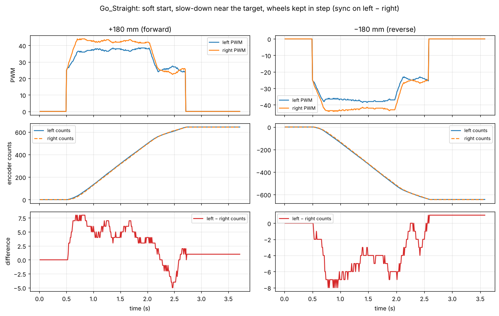

# 01 — Go Straight: encoder-synchronised straight driving and Wi-Fi logging

[← back to the overview](../README.md)

## Goal

Drive the robot a set distance in a straight line with both wheels kept in step, start without pressing a button,
and record every run as a CSV on the laptop — even if the laptop joins the robot's Wi-Fi late. This sketch is the
base of every later project and produced the straight-line data for [02](../02_wheel_radius/).

## Method

The controller runs every 10 ms on the StampC3 and reads the encoder counts from the 3Pi+ over I²C.

| Part | Rule |
|---|---|
| Target | `target_counts = TARGET_DISTANCE_MM / (2π · 16.0) · 358.3` (nominal radius) |
| Speed | `|PWM| = 0.3 × counts still to go`, limited to 25–40; 200 ms soft start from 25 |
| Straightness | `correction = 0.5 × (left − right counts)` (±10 max); `left = base − correction`, `right = base + correction` |
| Stop | when the mean of the two wheels reaches the target (never drives back) |
| Timing | 10 s countdown (LED blue, last 3 s yellow + beep) → 0.5 s still → drive (green) → motors off (red) → 1 s more logging |

CSV columns: `run,time_ms,left_pwm,right_pwm,left_counts,right_counts,diff` (10 ms rows).
Every row is also stored in RAM; when a laptop connects after the run (or `wifi_logger.py` sends `R`), the whole run is
replayed. A random boot id lets the logger save each run exactly once.

## Experimental process

1. Upload `Go_Straight/Go_Straight.ino` with `TARGET_DISTANCE_MM` set to the trial distance.
2. Run `python3 wifi_logger.py` on the laptop, place the robot on the start mark and power it on.
3. The robot waits 10 s, drives, stops; the logger writes `logs/<prefix>_<date>_<time>.csv`.
4. Measure the travelled distance with a ruler (used in [02](../02_wheel_radius/)).

## Results

* The right motor is weaker: in steady driving it needs about 4–5 PWM more than the left (left ≈ 37, right ≈ 42)
  to keep the counts equal — the synchronisation supplies this automatically.
* The right wheel starts 20–30 ms later than the left, so the left wheel leads by up to 8–9 counts in the first
  0.3 s; the controller pulls the difference back to 1–4 counts at the end of every run.
* Because the lead happens early, the odometry heading swings by about 1.5° and the robot ends 1–3 mm to the side
  (towards −y) in both directions — the reason a feed-forward or PID term was considered later.

## Files

| Path | What it is |
|---|---|
| `Go_Straight/` | Arduino sketch (`Go_Straight.ino` + robot support files) |
| `wifi_logger.py` | Laptop logger: one CSV per run, resend after late connection, no duplicates |
| `media/go_straight_runs.png` | Figure above (made from `../02_wheel_radius/data/18cm.csv`, `-18cm.csv`) |
