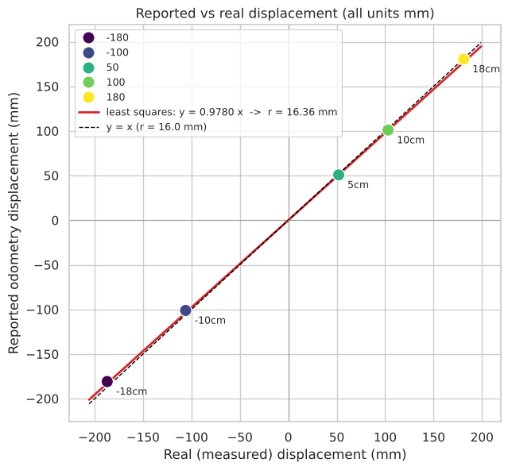

# 02 — Effective wheel radius (Odometry Exercise 2)

[← back to the overview](../README.md)

## Goal

Find the effective wheel radius r that makes the distance reported by the robot's encoder odometry match the
distance measured with a ruler. The supplied model assumes r = 16.0 mm for both wheels.

## Method

For the same encoder count n, odometry reports `(2π · r_model / 358.3) · n` while the robot really moves
`(2π · r_true / 358.3) · n`. So `reported = k · real` with `k = r_model / r_true`, and

**r_true = r_model / k**, with k fitted by least squares through the origin over all trials.

## Experimental process

1. Five straight runs with [01 — Go Straight](../01_go_straight/): +5, +10, +18 cm forward and −10, −18 cm reverse.
2. Each run logged over Wi-Fi (`data/*.csv`); the chassis reference point measured on the printed sheet before and
   after the run (`data/measurements.csv`).
3. "Reported" displacement: the logged counts replayed through the same Euler model as `OdometryModel.cpp`
   (r = 16.0, B = 90.0).
4. Least-squares slope, single-trial radii, forward/reverse split in the notebook (run in Google Colab).

## Results

| Trial | CSV | Command | Measured | Reported (r = 16.0) | Single-trial r |
|---|---|---|---|---|---|
| 1 | `data/5cm.csv` | +50 | +52 | +50.78 | 16.39 |
| 2 | `data/10cm.csv` | +100 | +103 | +101.00 | 16.32 |
| 3 | `data/18cm.csv` | +180 | +181 | +180.53 | 16.04 |
| 4 | `data/-10cm.csv` | −100 | −106 | −101.13 | 16.77 |
| 5 | `data/-18cm.csv` | −180 | −187 | −180.81 | 16.55 |

| Quantity | Value |
|---|---|
| Slope k = reported / real | **0.9780 ± 0.0079**, R² = 0.9997 |
| Effective radius r = 16.0 / k | **16.36 ± 0.13 mm** |
| Fit with intercept y = a·x + b | a = 0.9772, b = 1.67 mm → r = 16.37 mm |
| Forward trials only / reverse only | r = 16.12 mm / 16.60 mm |

## Discussion

* The robot travels about 2 % further than the default model says, so r = 16.36 mm is used from here on.
* Reverse runs travelled 5–6 mm further than reported, forward runs 0.5–2 mm: a direction-dependent effect (slip,
  start/stop behaviour or measurement) that one trial per condition cannot resolve.
* The ± values describe the scatter of five points only; the result is an *effective* radius for this surface and
  load, not the geometric wheel radius.

## Files

| Path | What it is |
|---|---|
| `data/*.csv` | Raw logs (`run,time_ms,left_pwm,right_pwm,left_counts,right_counts,diff`) |
| `data/measurements.csv` | Ruler measurements (编号 / trial, CSV, 方向 / direction, 实际距离 / measured mm) |
| `analysis/odometry_exercise02_wheel_radius_CSY.ipynb` | Course notebook adapted to this data, with outputs (reads the Google Sheet and CSVs from Google Drive) |
| `analysis/least_squares_fit.png` | Figure above |
