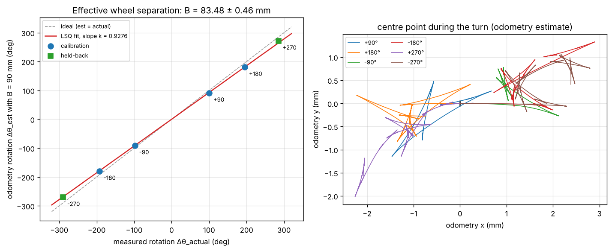

# 03 — Effective wheel separation (Odometry Exercise 3)

[← back to the overview](../README.md)

## Goal

Find the effective wheel separation B that makes the heading change reported by odometry match the turn measured
on the printed radial marker, with the radius from [02](../02_wheel_radius/) (r = 16.36 mm). The supplied model
assumes B = 90 mm.

## Method

Odometry computes `Δθ = (s_R − s_L) / B`, so the estimated turn is inversely proportional to B:

**B_new = B_old · Δθ_est / Δθ_actual**, with B_old = 90 mm.

±90° and ±180° are used for calibration — least squares through the origin, `Δθ_est = k · Δθ_actual`,
`B = 90 · k` — and **±270° is held back** to test the result.

The sketch `Rotate/` turns on the spot by `TARGET_ANGLE_DEG`: each wheel drives
`|angle| · (B/2) / (2π r) · 358.3` counts in opposite directions, and `left + right` counts are held at 0 so the
centre point does not wander (odometry keeps it within 3 mm of the start throughout every turn).

## Experimental process

1. Set `TARGET_ANGLE_DEG` (+ = anticlockwise), upload, place the axle midpoint on the centre of the radial marker,
   front on the 0° line.
2. Power on with `Rotate/wifi_logger.py` running; files are named `rot_<angle>deg_t<trial>` automatically.
3. Read the final heading on the marker; record signed total turn (e.g. 3° past a full 180° turn = 183°).
4. Notebook: odometry replay in the course's column format, per-trial B, least-squares fit, held-back test,
   sensitivity to the reading (run in Google Colab).

## Results

| Commanded | Role | Measured | Odometry with B = 90 | Single-trial B |
|---|---|---|---|---|
| +90 | calibration | +100 | +90.59 | 81.53 |
| +180 | calibration | +195 | +180.27 | 83.20 |
| −90 | calibration | −98 | −91.50 | 84.03 |
| −180 | calibration | −193 | −180.45 | 84.15 |
| +270 | held-back | +285 | +271.04 | 85.59 |
| −270 | held-back | −290 | −270.67 | 84.00 |

| Quantity | Value |
|---|---|
| Slope k = Δθ_est / Δθ_actual | **0.9276 ± 0.0051** |
| Effective separation B = 90 · k | **83.48 ± 0.46 mm** |
| Single-trial B (calibration set) | mean 83.23, median 83.62, sd 1.21 mm |
| Held-back ±270°: mean heading error | **16.6° with B = 90 → 4.5° with B = 83.48** (+270: −7.2°, −270: +1.8°) |

## Discussion

* The robot always turned further than odometry reported (5–10 %), so B = 90 mm was too large.
* Clockwise single-trial values agree closely (84.0–84.2 mm); anticlockwise ones spread more (81.5–85.6 mm).
* One physical reading per condition (the brief asks for ≥ 5), so ± 0.46 mm is optimistic. A 1° reading error moves
  a 90° trial's B by about 0.8 mm; reading +180° as 185° instead of 195° would give B = 85.18 mm.
* `*_extra.csv` are earlier attempts without a physical reading; kept as raw data, excluded from the fit.

## Files

| Path | What it is |
|---|---|
| `Rotate/` | Sketch (on-the-spot turn, persistent trial counter) and its `wifi_logger.py` |
| `data/*.csv` | Turn logs named by commanded angle (`90deg.csv`, `-270deg.csv`, …) |
| `measurements.csv` | Measured turn, role (calibration / held-back / not measured) and notes per log |
| `analysis/odometry_exercise03_wheel_separation_CSY.ipynb` | Notebook with outputs — [open in Colab](https://colab.research.google.com/github/comradeofjustice/Bristol_odometry/blob/main/03_wheel_separation/analysis/odometry_exercise03_wheel_separation_CSY.ipynb) |
| `analysis/rotation_fit.png` | Figure above |
