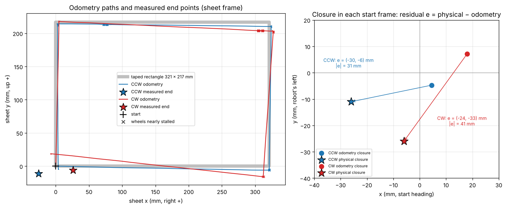
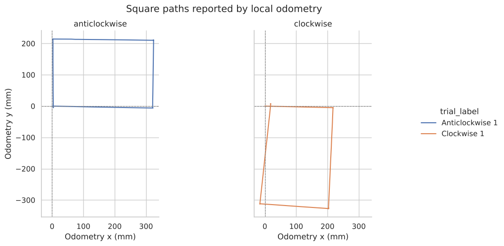

# 04 — Bidirectional rectangle benchmark (Odometry Exercise 4)

[← back to the overview](../README.md)

## Goal

With the calibrated geometry **frozen** (r = 16.36 mm from [02](../02_wheel_radius/), B = 83.48 mm from
[03](../03_wheel_separation/)), drive a closed rectangle in both directions using only the encoders (no line
following) and measure how far the robot really ends from where its odometry thinks it is (UMBmark-style test).

## Method

For each trial, in the start frame (x = initial heading, y = robot's left):

* physical closure `c` = measured end − measured start,
* odometry closure `Δodom` = final − initial odometry pose,
* **residual `e = c − Δodom`** = the error the odometry cannot see.

Systematic errors (wrong B: mirror-image CW/CCW offsets; unequal wheel diameters: one direction adds, the other
cancels) show as the centres of the CW and CCW groups; random errors (slip, placement) as the spread within a group.

## Experimental process

1. Sketch `System_error/`: 321 × 217 mm rectangle (the taped rectangle on the sheet), start at the bottom-left
   corner; `LOOP_DIRECTION = +1` anticlockwise (start facing right), `-1` clockwise (start facing up). Each side and
   each 90° turn is an encoder closed-loop segment with a 0.4 s pause after it; the run is sent over Wi-Fi only after
   the robot has stopped.
2. Mark the start, run the loop, measure the end displacement of the robot centre on the sheet (right +, up +).
3. Convert to the start frame (CCW: x = sheet x, y = sheet y; CW: x = sheet y, y = −sheet x) and compute c, Δodom,
   e in the course notebook (run in Google Colab).

## Results (first trial in each direction)

| Direction | Physical closure c | Odometry closure Δodom | Residual e | \|e\| |
|---|---|---|---|---|
| anticlockwise | (−26, −11) mm | (4.5, −4.7) mm, +1.9° | (−30.4, −6.3) mm | **31.1 mm** |
| clockwise | (−6, −26) mm | (18.0, 7.1) mm, −6.8° | (−24.0, −33.1) mm | **40.9 mm** |

## Discussion

* Odometry believes it returned within 6–19 mm of the start, while the robot really ended 27–28 mm away: about
  3–4 % of the 1.08 m path is lost without the odometry noticing.
* On the sheet the two end points lie roughly mirror-imaged left and right of the start (−26 / +26 mm), which is the
  signature of a turn-angle (B-type) error — but with one trial per direction this is only a hint.
* In both trials the wheels nearly stalled on the **top edge** of the rectangle (×-marks in the figure: CCW ≈ 1.1 s,
  CW repeated short stalls and ~2 s crawling at the minimum PWM of 25); a stall can make the wheels slip, which the
  encoders cannot see. These are environmental effects to remove before the remaining trials.
* Still to do for the brief: ≥ 5 trials per direction and the final heading of every trial (front and rear marks).

## Files

| Path | What it is |
|---|---|
| `System_error/` | Sketch (rectangle, `LOOP_DIRECTION`, record sent after the run) and its `wifi_logger.py` (`sq_<dir>_t<trial>`) |
| `data/ccw_trial1.csv`, `data/cw_trial1.csv` | Raw logs (`run,time_ms,segment,left_pwm,right_pwm,left_counts,right_counts,x_mm,y_mm,theta_rad`, 20 ms rows) |
| `data/odometry_exercise04_square_trials.csv` | Both runs in the course notebook's format |
| `measurements_sheet_frame.csv` | Measured end displacement on the sheet, geometry, notes per trial |
| `analysis/odometry_exercise04_square_benchmark_CSY.ipynb` | Course notebook with only the data cells changed — [open in Colab](https://colab.research.google.com/github/comradeofjustice/Bristol_odometry/blob/main/04_square_benchmark/analysis/odometry_exercise04_square_benchmark_CSY.ipynb) |
| `analysis/*.png` | Figures above and the course notebook's closure plot |
