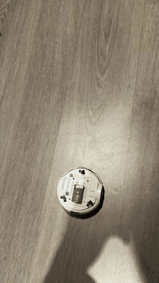
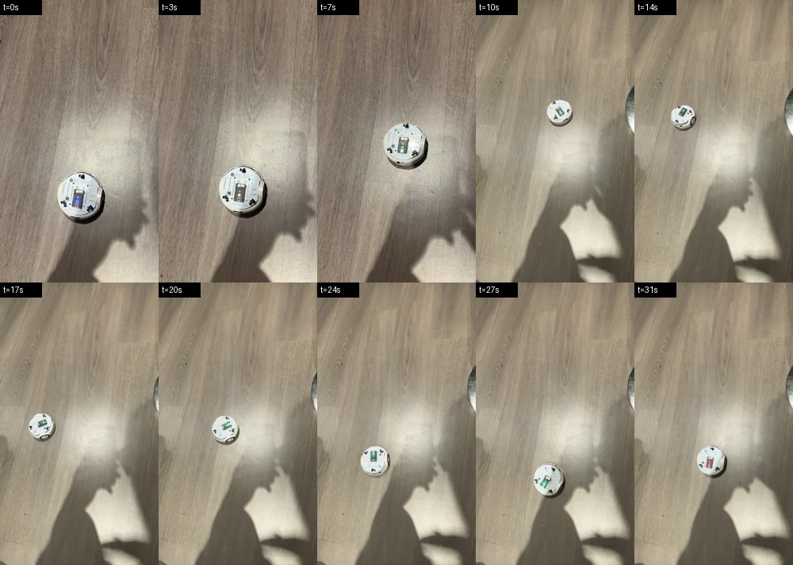
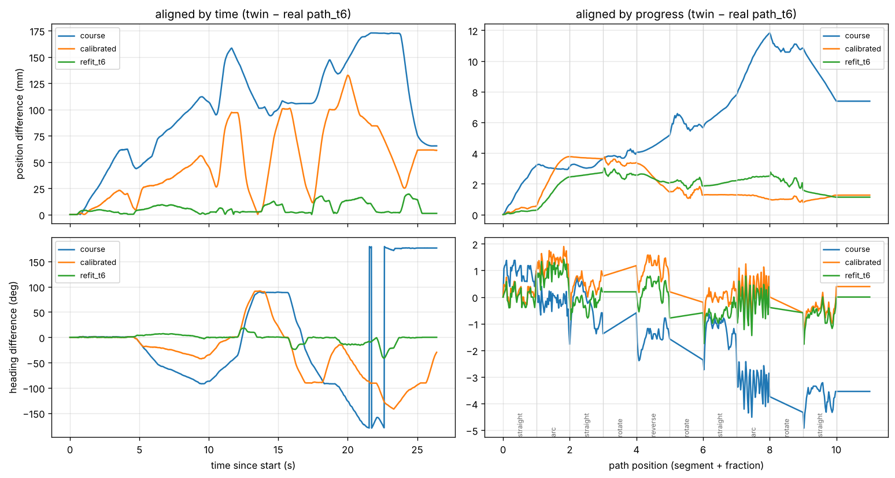
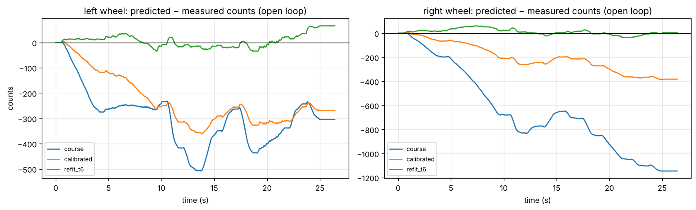

# 05 — Path Reproduction: physical robot vs Digital Twin (group project)

[← back to the overview](../README.md)

  

<em>Real run on a wooden floor (4× speed; full video: <a href="media/path_run_floor.mp4">media/path_run_floor.mp4</a>)</em>

## Goal

Project 04 of *Select a project* (Motors · odometry): design a path with different types of motion, run it on the
real robot and in the Digital Twin, and find **where and when the two diverge, which motions produce the largest
differences, and which model assumptions explain them** — then use the differences to update the twin.

## The path

Start: axle midpoint at the origin, facing +x. The designed path closes on itself (end = start, 360°).

| # | Motion | Type | Max PWM | Left / right wheel (mm) |
|---|---|---|---|---|
| 1 | straight 200 | straight, slow | 30 | 200.0 / 200.0 |
| 2 | arc left, R 80, 180° | wide arc | 35 | 120.2 / 382.5 |
| 3 | straight 100 | straight, **fast** | 50 | 100.0 / 100.0 |
| 4 | rotate −90° (CW) | rotation | 35 | 65.6 / −65.6 |
| 5 | straight −100 | **reversal** | 35 | −100.0 / −100.0 |
| 6 | rotate +90° (CCW) | rotation | 35 | −65.6 / 65.6 |
| 7 | straight 100 | straight | 40 | 100.0 / 100.0 |
| 8 | arc left, R 60, 90° | **tight arc** (inner wheel near the deadband) | 35 | 28.7 / 159.8 |
| 9 | rotate +90° (CCW) | rotation | 35 | −65.6 / 65.6 |
| 10 | straight 60 | straight, slow | 30 | 60.0 / 60.0 |

## Method

### One controller for every motion, implemented three times

Each segment becomes a left and a right wheel distance. One 10 ms controller drives any of them:
progress `p = counts / target` per wheel; speed `base = 0.3·(1 − p)·T_max` limited to [25, max PWM] with a 200 ms
soft start; each wheel `15 + (base − 15)·|T|/T_max` (deadband offset so the slow wheel of an arc still turns);
synchronisation `corr = 0.5·(p_L − p_R)·T_max`. For straights this is exactly [01](../01_go_straight/), for
rotations exactly [03](../03_wheel_separation/).

| Implementation | Where | Role |
|---|---|---|
| StampC3 firmware | `Path_Reproduction/` | runs on the robot; logs PWM, counts and its own odometry every 20 ms; sends after the run |
| Processing Digital Twin | `DigitalTwin_PathReproduction/` | the supplied twin, extended: same path and controller, switchable model, draws designed / twin / real paths, exports its runs |
| Python twin | `twin/twin.py`, `twin/compare.py` | identical model for batch runs and the analysis notebook |

**Verification:** the firmware's C++ was run in a host simulation with the calibrated physics and matched the Python
twin (same 1517 rows, segment ends within 40 ms and 3 counts). The Processing logic, compiled headless in Java,
matches Python within 1.1 mm (course model) and 4.4 mm (calibrated; float vs double at segment thresholds).

### Twin models

| Model | Motors | Geometry | Source |
|---|---|---|---|
| `course` | PWM → speed linear (PWM 200 = 0.25 mm/ms), wheels identical, no deadband, no lag | B = 90, r = 16 | the supplied twin |
| `calibrated` | v = k·(\|PWM\| − 14.9) above the deadband, k_L = 3.99, k_R = 3.12 mm/s per PWM, 5 ms lag, right wheel 20 ms late | B = 83.48, r = 16.36 | fitted to 14 real logs of 02–04 by replaying their PWM |
| `refit_t6` | as `calibrated`, k_L = 4.57, k_R = 3.37, deadband 14.1 | as above | **twin update**: gains re-fitted on the real run `path_t6` |

All models apply the robot's integer PWM (`Robot.cpp` sends `(int16_t)pwm`), which alone slows the robot by 2–4 %.

## Experimental process

1. Upload `Path_Reproduction/Path_Reproduction.ino`, place the robot at the start facing +x, start
   `Path_Reproduction/wifi_logger.py`, power on; the path runs 10 s later and the record is sent when it stops.
2. Run the twins (Processing sketch or `python3 twin/twin.py`) — same path, same controller.
3. Compare in `analysis/path_reproduction_twin_vs_real.ipynb`:
   aligned **by time** (same moment) and **by progress** (same fraction of each segment, which removes timing),
   segment-local motion (each segment in its own start frame, so earlier errors are not counted twice),
   and open-loop replay of the real PWM through each motor model.

Run `path_t6` (wooden floor, fresh batteries) completed all 10 segments in 25.4 s. Two earlier attempts
(`data/real/failed_runs/`) timed out on segment 1 with 0 encoder counts while PWM 25–30 was commanded for 10 s —
the motors had no battery power.

## Results

### Trajectories

### Where and when they diverge

| Model | Total time (real 26.4 s) | Time-aligned mean / max position difference | Progress-aligned max position / heading difference | First > 5 mm |
|---|---|---|---|---|
| `course` | 35.3 s | 100 / 173 mm | 11.8 mm / 4.9° | 1.0 s (segment 1) |
| `calibrated` | 30.3 s | 50 / 133 mm | 3.8 mm / 1.9° | 1.5 s (segment 1) |
| `refit_t6` | 26.7 s | **6 / 20 mm** | 3.0 mm / 1.8° | 5.3 s (segment 2) |

### Which motions differ most

Segment durations (s) — the largest differences are in **time**, and they are not uniform across motion types:

| # | Motion | Real | course | calibrated | refit_t6 |
|---|---|---|---|---|---|
| 1 | straight 200 slow | 3.60 | 5.36 | 4.20 | 3.58 |
| 2 | arc R80 180° | 5.50 | 7.28 | 6.50 | 5.54 |
| 3 | straight 100 **fast** (PWM 50) | 1.14 | 2.12 | 1.52 | **1.32** |
| 4 | rotate CW 90 | 1.22 | 1.74 | 1.40 | 1.20 |
| 5 | reverse 100 | 1.56 | 2.50 | 1.88 | 1.64 |
| 6 | rotate CCW 90 | 1.22 | 1.72 | 1.40 | 1.20 |
| 7 | straight 100 | 1.32 | 2.34 | 1.70 | 1.48 |
| 8 | arc R60 90° (tight) | 2.54 | 2.96 | 3.10 | 2.60 |
| 9 | rotate CCW 90 | 1.22 | 1.74 | 1.40 | 1.20 |
| 10 | straight 60 slow | 1.30 | 1.70 | 1.44 | 1.24 |

### Updating the twin: open-loop replay of the real PWM

## Discussion

* **The controller and encoder behaviour are reproduced closely.** Per segment the real wheel counts match the
  calibrated twin within about 5 counts (≈ 1.4 mm); the real odometry's sideways shift on each straight (−0.7 to −3.2 mm,
  left wheel leads at the start) appears in the calibrated twin through the right-wheel delay and not in the course twin.
* **Divergence starts with speed, not geometry.** By progress, all models stay within millimetres; by time, the twins
  drift apart within 1–1.5 s because the calibrated twin needed 11–33 % (mean ≈ 20 %) longer per segment than the real robot — motor gain depends
  on battery voltage and surface (this run: fresh batteries, wooden floor; the model was fitted on paper with used
  batteries).
* **Re-fitting two motor gains** cuts the open-loop count error from ≈ 244 to ≈ 26 counts rms and the time-aligned
  mean position difference from 50 to 6 mm. It was fitted and judged on the same run — it must be validated on another run.
* **The linear motor model fails at high PWM:** even after the refit the fast straight (PWM 50) takes 1.32 s in the twin
  against 1.14 s for real, while the slower segments match; speed rises faster than linearly with PWM.
* **Geometry is the largest physical risk:** with the course twin's B = 90 mm each commanded 90° turn becomes ≈ 82°.
  The robot's own odometry cannot reveal this (it uses the same B as its controller); physical checkpoints
  (`CHECKPOINT_PAUSE_MS = 3000`) are needed. The video was hand-held, so it is shown but not used for measurement.

**Next steps:** more real runs (validate `refit_t6`), a run with checkpoint marks for physical positions, a non-linear
PWM → speed map, and the same refit in the Processing twin.

## Files

| Path | What it is |
|---|---|
| `Path_Reproduction/` | Robot firmware and logger (`path_t<trial>_*.csv`) |
| `DigitalTwin_PathReproduction/` | Processing 4 sketch (based on the course `DigitalTwin`; `PathPlan`, `MotorsModel`, `RobotSimulation`, `Controller` replaced, `Simulator` extended; key C switches model, R restarts). The course `Controller.pde` referred to a non-existent type `RobotSimulation_c`; this version uses `Robot_c` |
| `twin/` | Python twin (`twin.py`, models `course`, `calibrated`, `refit_t6`) and comparison helpers (`compare.py`) |
| `data/real/path_t6.csv` | The real run; `failed_runs/` keeps the two runs without motor power |
| `data/twin/` | Twin runs exported by Python and by the Processing logic |
| `analysis/path_reproduction_twin_vs_real.ipynb` | Analysis notebook with outputs — [open in Colab](https://colab.research.google.com/github/comradeofjustice/Bristol_odometry/blob/main/05_path_reproduction/analysis/path_reproduction_twin_vs_real.ipynb) |
| `media/` | Video of the run (`path_run_floor.mp4`), 4× GIF and frame strip |
