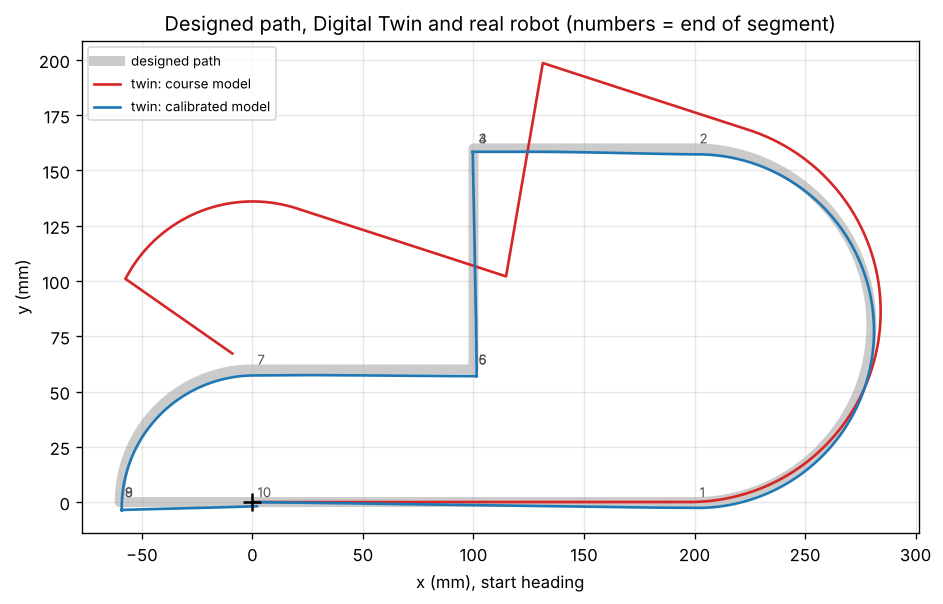

# 05 — Path Reproduction: physical robot vs Digital Twin (group project)

Project 04 of *Select a project* (Motors · odometry): a designed trajectory with different types of motion is run on
the real robot and in the Digital Twin, and the two are compared throughout the run to find where, when and why
they diverge.

## The path

Start: axle midpoint at the origin, facing +x. The path closes on itself (designed end = start, 360°).

| # | motion | type | max PWM | left / right wheel (mm) |
|---|---|---|---|---|
| 1 | straight 200 | straight, slow | 30 | 200.0 / 200.0 |
| 2 | arc left, R 80, 180° | wide arc | 35 | 120.2 / 382.5 |
| 3 | straight 100 | straight, fast | 50 | 100.0 / 100.0 |
| 4 | rotate −90° (CW) | rotation | 35 | 65.6 / −65.6 |
| 5 | straight −100 | **reversal** | 35 | −100.0 / −100.0 |
| 6 | rotate +90° (CCW) | rotation | 35 | −65.6 / 65.6 |
| 7 | straight 100 | straight | 40 | 100.0 / 100.0 |
| 8 | arc left, R 60, 90° | tight arc (inner wheel near the deadband) | 35 | 28.7 / 159.8 |
| 9 | rotate +90° (CCW) | rotation | 35 | −65.6 / 65.6 |
| 10 | straight 60 | straight, slow | 30 | 60.0 / 60.0 |

Fits in about 34 × 16 cm plus the robot radius (A3 test sheet).

## One controller, three implementations

Every segment becomes a left and a right wheel distance; one 10 ms controller drives any of them:
progress per wheel `p = counts / target`, speed `base = K_DIST·(1−p)·Tmax` limited to [25, max PWM], each wheel
`FF + (base − FF)·|T|/Tmax` (FF = 15, deadband offset for the slow wheel of an arc),
sync `corr = K_SYNC·(pL − pR)·Tmax`. For straights it is the Go_Straight controller, for rotations the Rotate one.

| Implementation | Where | Purpose |
|---|---|---|
| C++ firmware | `Path_Reproduction/Path_Reproduction.ino` | runs on the robot; logs counts, PWM and its own odometry every 20 ms; Wi-Fi only after the run |
| Processing Digital Twin | `DigitalTwin_PathReproduction/` | the supplied twin extended: same path and controller, switchable motor model, draws designed path / twin / real run, writes `twin_<model>_processing.csv` on start-up |
| Python twin | `twin/twin.py`, `twin/compare.py` | identical model for batch runs and the analysis notebook |

**Verification:** the C++ firmware was run in a host simulation with the calibrated physics and compared with the
Python twin (same 1517 rows, segment ends within 40 ms and 3 counts, odometry within 3.3 mm / 2°). The Processing
logic was compiled and run headless in Java: against Python it agrees within 1.1 mm (course model) and 4.4 mm
(calibrated, float vs double rounding at segment thresholds).

## Twin models

| Model | Motors | Geometry | Source |
|---|---|---|---|
| `course` | PWM → speed linear (PWM 200 = 0.25 mm/ms), both wheels equal, no deadband, no lag | B = 90, r = 16 | supplied twin |
| `calibrated` | v = k·(\|PWM\| − 14.9) above the deadband, k_left = 3.99, k_right = 3.12 mm/s per PWM, lag 5 ms, right wheel 20 ms late | B = 83.48, r = 16.36 | fitted to 14 real logs from Ex2–Ex4 by replaying their PWM |

Both models apply the robot's integer PWM truncation (`Robot.cpp` sends `(int16_t)pwm`), which slowed the robot
by 2–4 % against a float-PWM model.

## Results so far (twin vs twin; real runs pending)

* Rotations are the most model-sensitive motion: with B = 90 the course twin turns about 82° for each commanded
  90°, so every later segment points the wrong way; the 180° arc ends about 18° short.
* Straights differ by about 2 % in length (r) and 20–40 % in duration (PWM → speed map and deadband), so
  time-aligned comparisons diverge within the first second.
* After the whole path the two twins end about 70 mm and 37° apart.

## How to run

1. **Robot:** open `Path_Reproduction/Path_Reproduction.ino` in Arduino IDE (board M5StampC3, USB CDC On Boot
   Disabled, 115200), upload, place the robot at the start facing +x, power on, run
   `python3 wifi_logger.py` in the same folder. Set `CHECKPOINT_PAUSE_MS = 3000` for a run where you mark the robot
   after every segment.
2. **Twin (Processing 4):** open `DigitalTwin_PathReproduction/DigitalTwin_PathReproduction.pde`, press Run.
   C switches course / calibrated model, R restarts; copy a real log to `data/real_run.csv` to draw it.
3. **Analysis:** copy real logs to `data/real/` (and optional `checkpoints.csv`), then run
   `analysis/path_reproduction_twin_vs_real.ipynb`
   ([open in Colab](https://colab.research.google.com/github/comradeofjustice/Bristol_odometry/blob/main/05_path_reproduction/analysis/path_reproduction_twin_vs_real.ipynb)).

## Files

| Path | What it is |
|---|---|
| `Path_Reproduction/` | Robot firmware and its logger (`path_t<trial>_*.csv`). |
| `DigitalTwin_PathReproduction/` | Processing sketch (based on the course's `DigitalTwin`; `PathPlan`, `MotorsModel`, `RobotSimulation`, `Controller` replaced, `Simulator` extended). The course `Controller.pde` referred to a non-existent type `RobotSimulation_c`; this version uses `Robot_c`. |
| `twin/` | Python twin (`twin.py`) and comparison helpers (`compare.py`). |
| `data/twin/` | Twin runs from Python and Processing, both models. |
| `data/real/` | Real robot runs and checkpoint measurements (to be added). |
| `analysis/` | Notebook, `trajectories.png`, `divergence.png`. |
