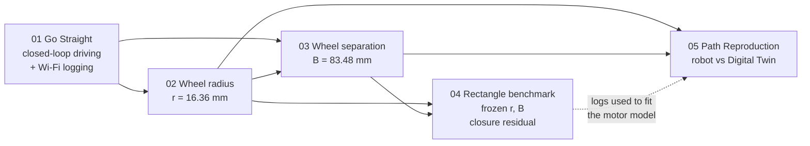

# Bristol odometry — Pololu 3Pi+ / M5Stack StampC3

**SEMTM0043/42 Robotics Science & Systems, University of Bristol (2026).**
Calibrating the encoder odometry of one Pololu 3Pi+ robot step by step, testing the calibrated model on a closed
loop, and comparing the real robot with its Digital Twin on a designed path.
All lengths in millimetres, angles in degrees, anticlockwise positive.

<p align="center">
  
  &nbsp;
  
</p>

## Projects

| # | Project | Question | Key result |
|---|---|---|---|
| [01](01_go_straight/) | **Go Straight** | Can the robot drive a set distance straight, and log every run reliably over Wi-Fi? | Encoder-synchronised controller; left − right counts stay within ±9 during a run, ±1–4 at the end |
| [02](02_wheel_radius/) | **Wheel radius** (Odometry Ex 2) | What effective wheel radius makes odometry distance match the ruler? | **r = 16.36 ± 0.13 mm** (model default 16.0) |
| [03](03_wheel_separation/) | **Wheel separation** (Odometry Ex 3) | What effective wheel separation makes odometry heading match the protractor? | **B = 83.48 ± 0.46 mm** (default 90); held-back ±270° heading error 16.6° → 4.5° |
| [04](04_square_benchmark/) | **Rectangle benchmark** (Odometry Ex 4) | With r and B frozen, how far is the robot really from where odometry thinks after a 321 × 217 mm loop? | Residual **31 mm** (CCW) and **41 mm** (CW), one trial each |
| [05](05_path_reproduction/) | **Path Reproduction** (group project) | Where, when and why do the real robot and its Digital Twin diverge on a path with straights, arcs, rotations, a reversal and speed changes? | Encoder behaviour matched within ≈ 5 counts per segment; divergence is driven by **speed** (battery / surface); re-fitting the motor gains cuts the time-aligned difference from 50 mm to 6 mm |

## How the projects build on each other



## Common setup

| Item | Setting |
|---|---|
| Robot | Pololu 3Pi+ 32U4 with M5Stack StampC3 (ESP32-C3) on top; 358.3 encoder counts per wheel revolution |
| Arduino IDE | board package M5Stack, board **M5StampC3**, USB CDC On Boot **Disabled**, upload speed 115200 |
| Wi-Fi | the robot is an access point `CSY`; each project has its own `wifi_logger.py` (Python standard library) |
| Start | no button: every sketch starts by itself 10 s after power-up; one run per power-up |
| Logging | all rows are kept in the robot's RAM and sent again when a laptop connects late; from 04 on, nothing is sent while the robot moves (a Wi-Fi send once stalled the control loop for 0.5 s) |
| Analysis | Jupyter notebooks, all run end to end in Google Colab (they clone this repository for their data) |

## Repository layout

```
01_go_straight/        firmware Go_Straight/ + wifi_logger.py + figure
02_wheel_radius/       data/ (5 straight runs, ruler) + analysis/ (notebook, fit)
03_wheel_separation/   Rotate/ firmware + data/ (turns) + measurements.csv + analysis/
04_square_benchmark/   System_error/ firmware + data/ + measurements_sheet_frame.csv + analysis/
05_path_reproduction/  Path_Reproduction/ firmware, DigitalTwin_PathReproduction/ (Processing),
                       twin/ (Python twin), data/ (real + twin runs), analysis/, media/ (video)
```
