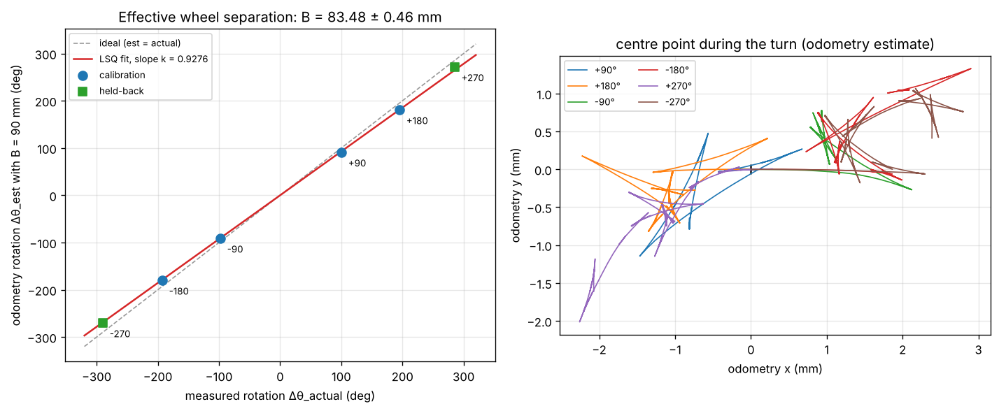
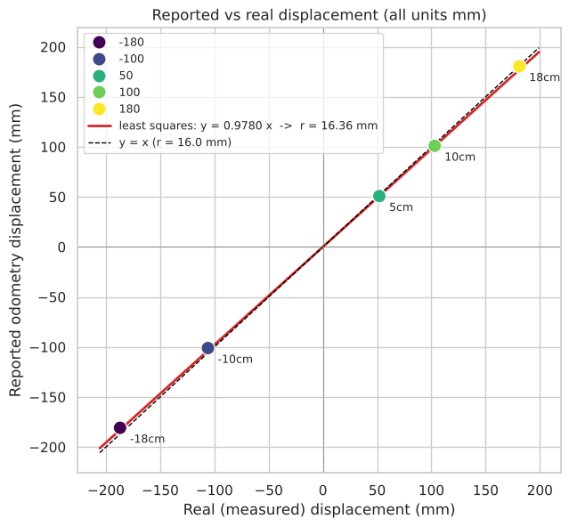

# Odometry calibration — Pololu 3Pi+ / M5Stack StampC3

SEMTM0043/42 Robotics Science & Systems, University of Bristol.
All lengths are in millimetres.

| Exercise | Parameter | Result |
|---|---|---|
| 2 — straight-line trials | effective wheel radius r | **16.36 mm** (± 0.13) |
| 3 — on-the-spot turns | effective wheel separation B | **83.48 mm** (± 0.46), given r = 16.36 mm |

# Exercise 3 — Effective wheel separation

Firmware `ex3_rotation/Rotate/` turns the robot on the spot by `TARGET_ANGLE_DEG`
(encoder closed loop, left + right counts held at 0 so the centre stays put; + = anticlockwise).
The heading change reported by odometry (r = 16.36 mm, B_old = 90 mm) is compared with the
turn measured on the printed radial marker. Because Δθ = (s_R − s_L) / B,

B_new = B_old · Δθ_est / Δθ_actual.

±90° and ±180° are used for calibration (least squares through the origin, Δθ_est = k · Δθ_actual,
B = B_old · k); ±270° is held back for evaluation.

| Commanded | Role | Measured (deg) | Odometry, B = 90 (deg) | Single-trial B (mm) |
|---|---|---|---|---|
| +90 | calibration | +100 | +90.59 | 81.53 |
| +180 | calibration | +195 | +180.27 | 83.20 |
| −90 | calibration | −98 | −91.50 | 84.03 |
| −180 | calibration | −193 | −180.45 | 84.15 |
| +270 | held-back | +285 | +271.04 | 85.59 |
| −270 | held-back | −290 | −270.67 | 84.00 |

| | Value |
|---|---|
| Slope k = Δθ_est / Δθ_actual | **0.9276** (± 0.0051) |
| Effective separation B = 90 · k | **83.48 mm** (± 0.46 mm) |
| Single-trial B, calibration set | mean 83.23, median 83.62, sd 1.21 mm |
| Held-back ±270°: mean heading error | **16.6° with B = 90 → 4.5° with B = 83.48** (+270: −7.2°, −270: +1.8°) |

Notes for discussion:

- The robot always turned further than odometry reported, so the 90 mm in the model was too large.
- Clockwise single-trial values agree closely (84.0–84.2 mm); anticlockwise ones spread more (81.5–85.6 mm).
- Odometry puts the centre point within 3 mm of the start throughout every turn.
- Only one physical reading per condition so far (the brief asks for ≥ 5), so the ± values are optimistic.
- Sensitivity to reading the protractor: if the +180° reading (195°) had been 185°, the fit would give B = 85.18 mm.
- `ex3_rotation/measurements.csv` also lists three logged runs with no physical reading
  (`*_extra.csv`: earlier +180, −90, −180 attempts); they are kept as raw data and excluded from the fit.
- Effective value: it depends on r, the surface, coasting after the motors stop and the measurement method.

# Exercise 2 — Effective wheel radius

## Result

Least-squares fit through the origin of **reported odometry displacement** against
**measured (real) displacement** over five trials:

| | Value |
|---|---|
| Slope k = reported / real | **0.9780** (± 0.0079), R² = 0.9997 |
| Effective wheel radius r = 16.0 / k | **16.36 mm** (± 0.13 mm) |
| Fit with intercept, y = a·x + b | a = 0.9772, b = 1.67 mm → r = 16.37 mm |
| Forward trials only | r = 16.12 mm |
| Reverse trials only | r = 16.60 mm |

Why the slope gives the radius: for the same encoder count n,
reported = (2π · r_standard / N) · n and real = (2π · r_true / N) · n, so
reported = (r_standard / r_true) · real. The slope is k = r_standard / r_true, hence
r_true = r_standard / k, with r_standard = 16.0 mm and N = 358.3 counts per revolution.

## Trials

| Trial | CSV | Command (mm) | Measured (mm) | Reported (mm) | Single-trial r (mm) |
|---|---|---|---|---|---|
| 1 | `data/5cm.csv` | +50 | +52 | +50.78 | 16.39 |
| 2 | `data/10cm.csv` | +100 | +103 | +101.00 | 16.32 |
| 3 | `data/18cm.csv` | +180 | +181 | +180.53 | 16.04 |
| 4 | `data/-10cm.csv` | −100 | −106 | −101.13 | 16.77 |
| 5 | `data/-18cm.csv` | −180 | −187 | −180.81 | 16.55 |

"Reported" is the local odometry displacement: the logged encoder counts replayed through
the same first-order Euler model as `OdometryModel.cpp` (r = 16.0 mm, B = 90.0 mm).
"Measured" is the ruler measurement of the same chassis reference point along the printed x axis.

Notes for discussion:

- Only one trial per condition, so the ± values describe the scatter of these five points only.
- Reverse trials travelled 5–6 mm further than reported, forward trials 0.5–2 mm. This suggests
  a direction-dependent effect (slip, start/stop behaviour or measurement), worth more repeats.
- The result is an effective radius for this surface and load, not necessarily the geometric
  wheel radius.

## Repository contents

| Path | What it is |
|---|---|
| `Go_Straight/` | Arduino sketch for the StampC3. Drives `TARGET_DISTANCE_MM` in a straight line (encoder-synchronised wheels, closed-loop stop), logs CSV over Wi-Fi and USB, keeps the run in RAM and resends it if the laptop connects late. |
| `wifi_logger.py` | Laptop logger (Python standard library only). Saves one CSV per run, requests a resend after late connection, never saves a run twice. |
| `data/*.csv` | Raw logs: `run,time_ms,left_pwm,right_pwm,left_counts,right_counts,diff` (counts since start of run, 10 ms rows: 0.5 s still, drive, 1 s after motors off). |
| `data/measurements.csv` | Ruler measurements (编号, CSV, 方向, 实际距离 mm). |
| `analysis/odometry_exercise02_wheel_radius_CSY.ipynb` | Colab notebook (based on the course notebook) with outputs. Reads the Google Sheet and the CSVs from Google Drive; set `USE_EXAMPLE_DATA = True` to run on synthetic data. |
| `analysis/least_squares_fit.png` | The final least-squares plot. |
| `ex3_rotation/Rotate/` | Exercise 3 sketch (on-the-spot turn, persistent trial counter) and its `wifi_logger.py`, which names files `rot_<angle>deg_t<trial>_*.csv`. |
| `ex3_rotation/data/*.csv` | Raw turn logs (same columns as above), named by commanded angle, e.g. `90deg.csv`, `-270deg.csv`. |
| `ex3_rotation/measurements.csv` | Measured turn per log, role (calibration / held-back / not measured), notes. |
| `ex3_rotation/analysis/odometry_exercise03_wheel_separation_CSY.ipynb` | Exercise 3 analysis with outputs: odometry replay in the course column format, per-trial B, least-squares fit, held-back test, sensitivity. Runs locally or in Colab (clones this repo). |

Board setup: Arduino IDE, M5Stack board package, board **M5StampC3**, USB CDC On Boot **Disabled**,
upload speed 115200.
